# AlphaEvolve: A Coding Agent for Scientific and Algorithmic Discovery

_精读笔记｜arXiv:2506.13131v1，2025-06-16｜PDF 共 44 页；阅读范围：主文、消融及数学构造附录_

---

## 📋 书目信息与核心问题

- **作者：** Alexander Novikov、Ngân Vũ、Marvin Eisenberger、Emilien Dupont、Po-Sen Huang、Adam Zsolt Wagner、Sergey Shirobokov、Borislav Kozlovskii 等，Google DeepMind
- **来源：** [arXiv:2506.13131v1](https://arxiv.org/abs/2506.13131v1)；作者称本文为 white paper
- **问题：** 能否将 LLM 的代码修改能力与可执行评估、程序库和进化搜索结合，持续改进可编程、可度量的数学、算法及工程问题？
- **范围：** 系统接口与搜索闭环、矩阵乘法算法、数学构造、Google 计算基础设施案例、消融和作者讨论；未复现实验

AlphaEvolve 的分工是人定义“要解决什么”及评估标准，系统搜索“如何实现”。它不是单轮代码生成器，而是把候选程序、运行结果和评分纳入跨轮搜索。论文最重要的系统主张不是 LLM 自己保证正确，而是自动评估器把生成建议放进一个可执行、可筛选的闭环中。[^1]

## ⚙️ 方法：评估驱动的进化闭环

用户提供初始程序、可演化代码区块、背景提示和评估代码。评估器将候选程序 \(P\) 映射为分数向量 \(h(P)=(s_1,\ldots,s_k)\)：\(P\) 是候选程序，\(s_i\) 是第 \(i\) 个标量评价指标，\(k\) 是指标数；系统约定分数越高越好。多指标既可直接表达多目标需求，也可增加高分候选的结构多样性。[^1, §§2.1–2.4, PDF pp.3–8]

下面的流程图按论文 Figure 2（PDF p.4）重述；其中“程序库”既存候选代码，也存其质量分数和反馈。

```mermaid
flowchart LR
    accTitle: AlphaEvolve Search Loop
    accDescr: Human-defined programs and evaluators enter a loop where a sampler builds context, language models propose patches, evaluators score candidates, and a program database feeds selected candidates back into search

    task_spec[👤 Define task and evaluator] --> sample_context[⚙️ Sample parent and inspirations]
    program_pool[(💾 Candidate program database)] --> sample_context
    sample_context --> build_prompt[📋 Build rich prompt]
    build_prompt --> propose_patch[🤖 Generate code patch]
    propose_patch --> apply_patch[⚙️ Apply patch to program]
    apply_patch --> evaluate_candidate[🔍 Evaluate candidate]
    evaluate_candidate --> update_pool[💾 Store scores and feedback]
    update_pool --> program_pool
```

核心步骤如下：

1. **提示采样：** 从程序库抽取父程序和其他启发候选，加入问题说明、代码、历史运行结果及可选文献等上下文。
2. **代码提案：** LLM 生成 SEARCH/REPLACE 补丁，或在适当设置下直接生成整个区块；补丁应用后形成子程序。
3. **级联评估：** 先运行便宜的小规模检查，候选通过后再进入耗时更大的任务评估；某些任务的评估可并行。LLM 分数可以补充难以形式化的性质，但不取代执行评估。
4. **候选记忆与选择：** 数据库设计参考 MAP-Elites 与岛屿式种群，尝试同时保留高分和多样性程序；完整流水线异步运行，目标是在总预算内提出并评估更多方案。

AlphaEvolve 可由不同抽象层级表示搜索对象：直接搜索最终构造、搜索从头构造它的函数、搜索固定预算内改进构造的算法，或共同演化中间构造与搜索算法。数学构造实验中，后一种“演化启发式、继承当前最好构造、再在预算内精修”的两层搜索尤其重要：早期启发式偏向大幅改进，后期启发式偏向近优解精修（§2.1、§3.2，PDF pp.5、12–13）。[^1]

## 📊 结果与证据

### 矩阵乘法与精确性

矩阵乘法可表示为三阶张量的秩一项分解；分解秩 \(R\) 对应所需的标量乘法次数。此处“秩”不是矩阵的普通线性代数秩，而是矩阵乘法张量分解中项数的最小值或其上界。作者搜索分解程序，并在评估时将系数舍入到整数或半整数，再检查精确乘法恒等式，以避免把浮点近似误认为精确算法（§3.1，PDF pp.9–10）。[^1]

附录 Table 3 报告 54 个矩阵尺寸：AlphaEvolve 在 38 项追平当时最好秩上界，在 14 项超过，在 2 项落后（PDF p.34）。最突出的例子是两个 \(4\times4\) 复矩阵相乘：AlphaEvolve 找到需要 48 次复数标量乘法的精确算法，优于递归 Strassen 的 49 次。此处结果针对特征为 0 的域；有限域 \(\mathbb F_2\) 上已有不同的 47 次算法，不能混为同一条件下的比较。复数乘法计数也不直接意味着实际硬件上的运行时间更快。[^1, §3.1、Table 3, PDF pp.9–10、34]

### 数学构造

作者在 50 多个数学问题上报告：约 75% 找回已有最好构造，约 20% 找到优于此前记录的新构造（§3.2，PDF pp.10、13）。例子包括：11 维 kissing number 的已知下界由 592 提高到 593；Erdős minimum overlap 问题的上界由 0.380927 微调到 0.380924；以及多项 packing、自相关不等式和有限集合和差集构造。这里改进的是构造给出的界，不表示已证明相应问题的全局最优值。[^1, §3.2、Appendix B, PDF pp.10–13、38–44]

一个可核验的证明示例是 11 维 kissing 构造。设 \(C\subset\mathbb R^d\setminus\{0\}\)，其中 \(d\) 是空间维数；令不同点的最小间距不小于点集最大范数，即

\[
\min_{x\ne y\in C}\|x-y\|\ge \max_{x\in C}\|x\|.
\]

对每个 \(x\in C\)，取球心 \(c_x=2x/\|x\|\)。这里 \(\|\cdot\|\) 是欧氏范数，\(\langle x,y\rangle\) 是欧氏内积。将上面的距离条件平方并展开，可得

\[
2\langle x,y\rangle\le \min(\|x\|^2,\|y\|^2)\le \|x\|\,\|y\|.
\]

因此 \(\|c_x-c_y\|\ge2\)，且 \(\|c_x\|=2\)：以 \(c_x\) 为球心、半径为 1 的单位球都与原点的单位球相切，并且彼此不重叠。于是点集 \(C\) 的大小给出 kissing number 的下界。论文报告 AlphaEvolve 找到 593 个满足条件的整数坐标点，故得到 593 的下界；这并不证明最优 kissing number 恰为 593（Appendix B.11，PDF p.43）。[^1]

### 生产计算案例

- **Borg 数据中心调度：** 进化得到的 CPU/内存余量评分函数在历史模拟器和未见近期负载上优于旧启发式，随后部署。作者报告全机群平均回收约 0.7% 的计算资源。由于该分数只对 Borg 已认定可运行作业的机器排序，作者称调度可行性由外层系统约束保证（§3.3.1，PDF p.14）。[^1]
- **Gemini 训练 kernel：** 搜索重要矩阵乘法 kernel 的 tiling heuristic，输入形状约一半用于搜索、一半用于评估。作者报告在评估形状上平均加速 23%，对应 Gemini 总训练时间降低约 1%，并称该启发式已部署（§3.3.2，PDF pp.15–16）。[^1]
- **TPU 算术电路：** 修改已高度优化的 Verilog 电路，删除不必要位宽；TPU 设计人员验证了功能正确性并将修改集成进后续 TPU。论文同时说明该简化也被下游综合工具独立发现，因此不能把它表述成 AlphaEvolve 单独带来的最终芯片收益（§3.3.3，PDF p.16）。[^1]
- **XLA 生成的 attention IR：** 对指定 GPU 推理配置，作者报告 attention kernel 提速 32%，相关输入预处理和输出后处理提速 15%。候选先与未修改参考实现进行随机输入对比，再由专家确认所有输入正确；随机测试本身不构成全域证明（§3.3.4，PDF p.17）。[^1]

## 🔍 消融、局限与解读边界

Figure 8（PDF p.18）在矩阵张量分解和 kissing-number 搜索上比较完整方法与若干删减版本，包括无进化、无提示上下文；矩阵任务另测单一小模型、无 meta-prompt 演化和只演化 loss function。每条曲线平均三次随机种子运行，阴影显示跨运行/目标的变异。结果支持这些组件在所测任务中有贡献，但没有把每个组件在所有工程应用中的独立收益量化出来。[^1, §4, Figure 8, PDF pp.17–18]

- **任务边界：** 系统依赖可自动执行的 evaluator。人工实验难以自动化的科学问题不在本文已展示能力范围内；LLM 质量评分只是可选反馈，作者也未把它作为本文优化成熟的主场景。
- **计算成本与规模：** 作者指出，一次新候选评估在某些应用中可能消耗约百计算小时；依赖异步和并行提高预算吞吐。矩阵尺寸超过 \(\langle5,5,5\rangle\) 后，作者在单 GPU evaluator 的大量随机种子运行中遇到显存问题（Appendix A，PDF p.34）。
- **正确性并非单一等级：** 有的应用只在安全候选中重排；有的用精确代数恒等式；有的依赖随机回归测试和专家检查。论文不支持“自动评估器天然保证所有代码正确”的泛化结论。
- **外部复现：** 数学构造与验证代码指向作者附带的 Colab；Google 内部生产案例则没有提供可供外部完全重跑的负载、实现与成本数据。应区分公开可核验构造与公司内部部署报告。
- **比例口径：** 主文对 50 多个数学问题给约 75%/20% 的总体比例；矩阵乘法附录另对 54 种尺寸给出 38/14/2 的精确计数。这是两个不同子集，不能互换。

该 v1 PDF 的不确定性不等式部分还有阶段注记：Appendix B.4 主体写改进上界为 0.3521；紧接的注释称吸收后续精化后进一步到 0.3216。两数应按正文与注释所述的不同精化阶段解读，而不是同一构造的矛盾测量（PDF p.39）。[^1]

## 💡 研究价值与迁移建议

**阅读价值：高，建议 Tier 2。** 对代码搜索、kernel/solver 优化和评估驱动的 agent 系统具有直接参考价值。最值得迁移的是“人定义可靠评估器—程序化候选表示—分级成本筛选—多样性候选记忆”的系统分工；最不应照搬的是把特定内部部署收益当作跨硬件、跨负载的一般保证。

对 SCALE_Forge 或其他科学代码搜索框架，可借鉴并逐项验证：记录候选父代、改动、验证类型、训练/留出负载和累计成本；先做快速合法性与正确性筛选，再进行昂贵性能评估；把精确证明、受限语义变换、数值回归和专家审查作为不同等级的证据，不把它们混称为“验证通过”。这些是基于本文架构的迁移建议，并非作者已验证的结论。

## ❓ Review Questions

1. 在相同模型、评估次数和墙钟预算下，MAP-Elites/岛屿式候选库相对只保存当前冠军增加了多少有效发现？
2. 怎样为曲线网格 CFD 设计分级 evaluator，使离散合法性、守恒、边界条件和性能分别被检验，同时防止候选利用固定测试集？
3. 哪些数值任务能通过结构设计“按构造保持正确性”，哪些必须依赖收敛分析、守恒证明或对抗性回归？

## ✅ 流程状态

- 元数据：完成；指定来源为 arXiv v1，2025-06-16，44 页
- 原文：完成；本次读取全篇并重点核对主文 §§2–6 与 Appendix A–B，页码均指该 PDF
- 精读：完成；覆盖方法、主要结果、消融和数学构造证明
- 评估：完成；按 AI agent / 高性能代码搜索研究方向列 Tier 2
- 索引：已在 `CODEX_DEEP_READ.md` 的 Tier 2 中列出，本次同步更新描述
- Codex 审阅：本次未调用；没有跨模型复核
- 实验复现：未进行
- 提交/推送：未进行

[^1]: Novikov, A. et al. (2025). “AlphaEvolve: A Coding Agent for Scientific and Algorithmic Discovery.” arXiv:2506.13131v1. https://arxiv.org/pdf/2506.13131v1
