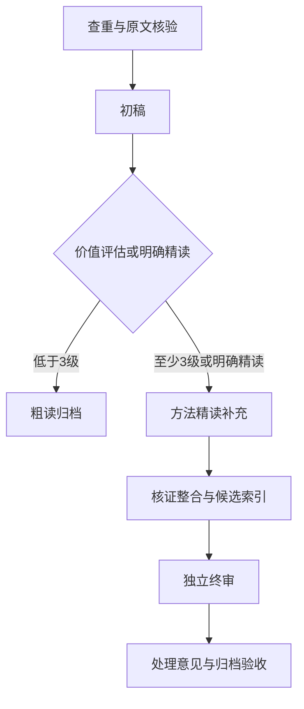

# 论文阅读、评估与归档流程

本流程以 paper-reader v1.0.7 为基础，已于2026-11-13 核对线上正文。查重、原文证据、价值分流、精读补充、独立终审，以及失败后保留成果的要求均予以保留。原流程中的 JARVIS/Codex 分工在这里改用角色描述，模型选择另行配置，使项目在没有安装原 skill 的环境中也能执行同一套流程。[^1]

## 输入与执行范围

开始前，主 Agent 记录论文标识、版本、任务模式和研究关注点。任务分为会话解释、归档、明确精读、重读/续做。“明确精读”表示用户已决定阅读深度，只豁免价值筛选，原文获取、精读补充和终审仍须完成。研究重点以当前 [精读索引](../CODEX_DEEP_READ.md) 为准；旧文档中的目录数量不作为固定值。

会话解释只返回答案和阅读范围，不自动改库。需要归档时，在仓库外的临时目录或本地 `.paper-runs/<唯一运行ID>/` 保存原文、提取文本、各阶段意见和运行记录，这些原始材料不自动纳入 Git。参照 [状态示例](run.example.json) 建立记录，填写实际路径、哈希和执行状态；示例本身不是完成凭据。

正式笔记须保留原文链接、版本、原始文件哈希、证据锚点和审阅摘要。归档前，再将最终运行记录、各阶段回执和意见处理记录保存到仓库内 `reading/records/<run_id>/`。保存时去除无关日志、敏感信息和本机绝对路径，保留模型、输入/输出哈希、阅读范围与结论。

公开原文应记录可重新获取的固定版本来源；本地私有原文或可变网页则需保留持久副本，并记录存放位置，不自动上传原文。临时提取文本可以清理，证据原件和关键回执需要长期保留。若恢复任务时发现证据已丢失，对应环节标为待重新核验，不补造通过凭据。

## 阶段与关口



任一依赖阶段失败时，其下游保持 pending；图中的后续箭头不表示失败后仍继续。独立的其他论文可继续处理。

| 阶段 | 输入与工作 | 离开阶段的条件 |
| --- | --- | --- |
| 查重 | DOI/arXiv ID、标题、版本，对照索引与实际文件 | 同版本已完成则返回现有路径；明确重读或未完成才续做。不同版本记录差异，不直接覆盖 |
| 元数据与原文 | 核对作者全名单、题名、发表信息、版本、摘要；获取公开 PDF 或用户原文 | 元数据核实，正文可读且阅读范围清楚；一个入口失败尝试合理备用入口 |
| 初稿 | 原文、研究主线、既有同类笔记 | 主 Agent 或初稿 Agent 输出待评估/待审笔记，不提前写“精读完成” |
| 价值评估 | 原文与初稿交独立 assessor | 六项证据说明、整体1–6级及理由；3级及以上进入精读，低于3级粗读。明确精读时记录 skipped 与用户要求 |
| 精读补充 | 原文与初稿交独立 method reader，可加并行 evidence reader | 方法、公式变量、算法步骤、实验口径、证据锚点与局限齐备；主 Agent 核实而非照抄 |
| 整合与候选索引 | 初稿及补充意见 | 主 Agent 逐条整合；精读索引候选明确“待终审”，保留原 Tier 与路线；粗读不进精读索引 |
| 独立终审 | 整合后的冻结笔记、对应原文、明确范围 | 新上下文 reviewer 给出可定位问题、严重程度与三个 Review Questions；运行成功不等于内容通过 |
| 归档验收 | 审阅意见及处理记录 | 主 Agent 核对原文、逐项说明采纳/不采纳原因；重大事实或公式修订后需针对新版本复核，期间标待审。通过后正式更新精读索引、README 条目和准确的统计，去掉本篇待审标记，核验链接并持久保存关键凭据，分别登记 index_published、links_verified、evidence_archived |
| 提交/推送 | 本次差异、用户明确要求 | 分别记录 commit/push 状态；无请求则 not_requested，不影响阅读完成 |

价值评估沿用原 skill 的六个方面：清晰 idea、可验证计算、预言/迁移价值、领域重要性、方法创新、发表/引用影响。每项说明依据和不确定性，再给出整体判断，不机械求和。期刊声誉或引用量单独不足以支持高分，判断仍要落到论文的方法和证据上。

整体1–6级衡量阅读价值，Tier 1–4 表示库内阅读优先级，两者的数值方向和用途不同，应分别记录。原 skill 没有提供逐级详细量表，本项目也不将另行设计的固定评分公式写成原版规则。

## 原文与笔记要求

获取 PDF 后，先检查文件类型及实际解析情况，避免将 HTML 落地页当成正文。逐页提取时保留 PDF 页码，并说明它与印刷页码的差异。扫描页需 OCR，提取后抽查公式和表格；发现符号缺失时，回看原页面或 TeX。若只有摘要可读，交付范围止于摘要级阅读，不继续标作全文精读；元数据尚未核实时，保留草稿和缺项，暂不正式入库。

重要结论逐条注明章节、页码、图表或公式编号。实验数字同时交代任务、基准、指标、比较对象、聚合方式和实验条件，例如 best-of-N 与均值应明确区分。作者结论、补充推导、Agent 评议和迁移设想也要分别标注，避免把阅读者的推断写成论文结论。

公式须解释变量、下标、参数、适用单位和假设。原图只选少量确有助于理解的内容，并标明来源、图号和页码。未运行实验时明确写“未复现”。

笔记内容至少覆盖以下字段，章节按论文组织，不强制所有文献用同一骨架：

- 题名、完整作者、DOI/arXiv 与版本、发表信息、原文链接、阅读范围。
- 研究问题、方法、关键公式与算法、结果证据、局限和适用条件。
- 价值评估与 Tier 建议分别记录；明确精读的评估豁免理由。
- 三个有价值的 Review Questions、各阶段状态、实际 reviewer 模型/范围、意见处理摘要。

## 失败、恢复与完成判定

每个模型阶段的单次目标上限为1800秒，不自动重试或更换后端。CLI 提供进程级硬截止；宿主工具若缺少硬超时能力，主 Agent 只能尽力监测、请求中止，并记录实际耗时，不能据此宣称严格保证1800秒。要求硬时限的任务，使用 CLI 或宿主中具备硬截止能力的后端。

遇到超时、调用失败、输出缺失或原文不足，保存已有产物、模型、输入哈希、错误及待完成阶段，并说明当前缺项。用户明确要求恢复后，创建新的 attempt ID 和输出路径，保留既有回执。

阶段状态使用 pending、running、completed、failed、skipped、not_requested。每个 completed 都要有产物和核验说明；skipped 要写明原因，仅用于明确精读的价值筛选或确实不适用的环节。默认只有 completed 才满足下游依赖，以下两个分支例外：

- 用户明确要求精读：记录 assess=skipped 并附用户要求，随后进入 deepen。
- 价值评估已完成且低于3级：精读专属阶段以 coarse 为原因标记 skipped，随后进入粗读 finalize；只更新 README，不发布精读索引。

除此之外，skipped 和 failed 均不满足依赖。终审还要分别记录 transport_success（是否返回有效结果）和 accepted（主 Agent 是否核证通过）：收到审阅结果与接受其结论是两件事。

恢复任务时，重新检查文件、哈希、Git 差异和依赖，不只看状态勾选。原文版本变化后，依赖它的初稿、评估、补充和审阅均失效；终审后笔记若有实质修改，旧审阅仍只覆盖旧哈希，新版标为待复核。仅涉及排版时，主 Agent 可记录差异并确认语义未变。

全文精读完成要求：查重、元数据、可读原文、初稿、价值评估或明确豁免、精读补充、核证整合、终审意见处理、索引与链接核验均落实。粗读不要求精读补充和终审，但要明确其证据深度；摘要级、粗读和精读在最终汇报中分别说明。提交与推送不是完成阅读的必要条件。

## 项目内调用工具

优先使用宿主子 Agent 工具，按 [角色协议](ROLES.md) 传递自包含任务和模型路由。没有子 Agent 工具但有 Codex CLI 时，可从仓库根目录运行 [阶段调用器](../scripts/paper_reader.py)：

```bash
python3 scripts/paper_reader.py --stage assess \
  --notes /tmp/paper-run/draft.md --source /tmp/paper-run/source.pdf \
  --scope '主文及附录；PDF pp. 1–18' \
  --output /tmp/paper-run/assess.txt --receipt /tmp/paper-run/assess.json \
  --timeout 1800 --dry-run
```

确认输入后去掉 `--dry-run` 才发起模型调用。`--stage deepen` 做精读补充，`--stage review` 读取整合后的笔记做终审；每次换新的 output/receipt。PDF 输入需要 PyMuPDF；带页码的 UTF-8 文本使用标准库即可。dry-run 只检查输入与生成派发内容，不算完成任何阅读阶段。

调用器仅处理三个独立模型阶段，不自动下载、查重、编排多 Agent、更新状态台账或索引，也不判断学术结论正确。多 Agent 编排与完成关口由执行本文件的主 Agent 负责。只有一个模型且无独立会话时可以继续制作初稿和自查，终审保持待完成。

[^1]: [paper-reader v1.0.7，ClawHub](https://clawhub.ai/wangzw928/skills/paper-reader)，2026-11-13 读取；线上发布者 wangzw928。后续上游更新须人工比较后迁移，不自动覆盖本项目流程。
