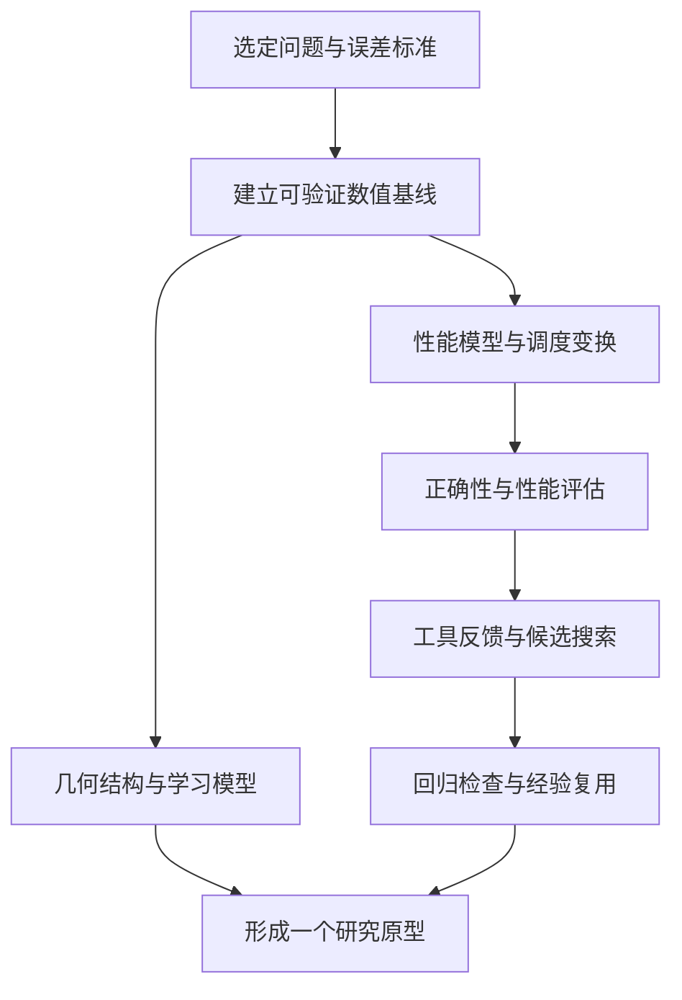

# Doctor 学习路线规划

*更新：2026-10-19｜以当前论文库与精读索引为依据*

> 导航：[完整文献目录](README.md) · [精读分层与阅读理由](CODEX_DEEP_READ.md)

当前库内有 **385 个文献 Markdown 文件、17 个分类**；其中 **72 篇标记为精读（71 篇论文、1 篇教材）**，分布于 15 个分类。本路线覆盖全部 72 篇精读文献，并保留原有 10 项待入库候选。计数按文件，不按独立论文去重。

本次依据本地笔记、README 和分层清单更新阅读状态、Tier 与路线。“精读”表示现有归档标记，阅读范围与原文核读情况以各篇笔记为准；阶段实验均为后续建议。

## Part 1: 研究主线与优先级

从当前文献结构看，路线可围绕一个共同问题组织：如何把几何结构、数值正确性和硬件性能落实为可验证的 PDE 求解与代码优化方法。物理与数学提供不变量和误差标准，数值方法提供可复用求解器，Agent 系统负责在明确的评估反馈下探索实现。

| 主线 | 当前学习重点 | 预期产出 |
| --- | --- | --- |
| AMR/PDE 与高性能计算 | Berger–Colella、JFNK、AMReX、Roofline、matrix-free multigrid | 数值基线、算子接口、性能瓶颈记录 |
| Agent 与 GPU 代码优化 | ReAct、SWE-agent、KernelBench、KernelPro、AlphaEvolve、K-Search | 可追溯的候选生成、评估与搜索流程 |
| 几何流体与结构保持 AI | Morrison–Greene、Madelung、HNN/LPNets、Covector Fluids、FNO | 不变量推导、长期误差实验、物理约束模型 |
| 量子与相对论专题 | Baym–Kadanoff、Schrödingerization、Einstein、洛伦兹变换教材 | 与主线对应的专题推导和适用条件 |

建议每个阶段选择一个主要实验；工程线与几何线共享同一组误差和性能记录。量子、相对论及生成式 PDE 专题按问题需要进入，避免把所有分支同时变成前置课程。

Tier 沿用分层清单：Tier 1 共 6 篇、Tier 2 共 38 篇、Tier 3 共 19 篇、Tier 4 共 8 篇；配套教材 1 篇不参加论文分层。Tier 是阅读优先级，路线中的先后还取决于知识依赖；低 Tier 的基础概念可按需先补。

## Part 2: 推荐论文与配套教材

> **覆盖说明（2026-10-19）**：A–E 保留原有 38 项编号推荐，其中 28 篇已有精读笔记、10 项为待入库候选；F–H 补入其余 43 篇精读论文和 1 篇教材，使本部分覆盖全部 72 篇精读文献。PRL 年度合集是额外检索入口，不作为单篇论文计数。候选书目信息沿用旧稿，正式入库时需核对原文及版本。

### A. 几何流体、Hamiltonian 结构与量子涡

1. **Hamiltonian description of the ideal fluid**
   - 当前索引：Tier 1；已有精读笔记。
   - 文件：[`geometric-fluid/hamiltonian-description-of-the-ideal-fluid.md`](geometric-fluid/hamiltonian-description-of-the-ideal-fluid.md)
   - Authors: P. J. Morrison
   - Year: 1998
   - DOI/arXiv: DOI `10.1103/RevModPhys.70.467`
   - Category: `geometric-fluid`
   - Type: 偏物理
   - Relevance: 这是现有 Tier 1 的理论底座，系统梳理非正则 Poisson bracket、Casimir、energy-Casimir stability、Clebsch variables 和流体约化。已有精读笔记（Tier 1），值得反复研读，用它统一仓库里的 Lie-Poisson NN、Covector Fluids、Schrödinger 表象。
   - Gap filled: 把现有几何流体论文从“单篇方法”提升到“非正则 Hamiltonian 场论体系”。

2. **Noncanonical Hamiltonian Density Formulation of Hydrodynamics and Ideal Magnetohydrodynamics**
   - 当前索引：Tier 1；已有精读笔记。
   - 文件：[`geometric-fluid/noncanonical-hamiltonian-density-formulation-of-hydrodynamics-and-ideal-magnetohydrodynamics.md`](geometric-fluid/noncanonical-hamiltonian-density-formulation-of-hydrodynamics-and-ideal-magnetohydrodynamics.md)
   - Authors: P. J. Morrison, J. M. Greene
   - Year: 1980
   - DOI/arXiv: DOI `10.1103/PhysRevLett.45.790`
   - Category: `geometric-fluid`
   - Type: 偏物理
   - Relevance: 非正则变量直接写 Poisson bracket 的源头之一，适合和 Morrison 1998 连读。对 Doctor 的价值在于理解为什么 Eulerian 变量不是 canonical，却仍可有 Hamiltonian 结构。
   - Gap filled: 补齐 Tier 1 综述背后的原始 PRL。

3. **Geometric Hydrodynamics via Madelung Transform**
   - 当前索引：Tier 2；已有精读笔记。
   - 文件：[`geometric-fluid/geometric-hydrodynamics-via-madelung-transform.md`](geometric-fluid/geometric-hydrodynamics-via-madelung-transform.md)
   - Authors: Boris Khesin, Gerard Misiołek, Klas Modin
   - Year: 2018/2019
   - DOI/arXiv: DOI `10.1073/pnas.1719346115`; arXiv `1711.00321`
   - Category: `geometric-fluid`
   - Type: 偏物理
   - Relevance: 把 compressible Euler、Schrödinger/NLS、Fisher-Rao/Sasaki geometry 和 Madelung transform 接在一起，是 Doctor 博客中量子传播子、Wick rotation 与几何流体之间的桥。
   - Gap filled: 当前为 Tier 2，作为“经典-量子-几何”之间的专题桥梁使用。

4. **The Madelung Transform as a Momentum Map**
   - 当前索引：Tier 2；已有精读笔记。
   - 文件：[`geometric-fluid/the-madelung-transform-as-a-momentum-map.md`](geometric-fluid/the-madelung-transform-as-a-momentum-map.md)
   - Authors: Daniel Fusca
   - Year: 2017
   - DOI/arXiv: DOI `10.3934/jgm.2017006`
   - Category: `geometric-fluid`
   - Type: 偏物理
   - Relevance: 从 momentum map 角度解释 Madelung 变换，和 Doctor 的辛几何/正则变换兴趣高度匹配。它能把“波函数变流体”从代数替换提升为群作用和 Poisson map。
   - Gap filled: 现有 Madelung 论文偏结果，这篇补机制。

5. **Inside Fluids: Clebsch Maps for Visualization and Processing**
   - 当前索引：Tier 4；已有精读笔记。
   - 文件：[`vortex-dynamics/inside-fluids-clebsch-maps-for-visualization-and-processing.md`](vortex-dynamics/inside-fluids-clebsch-maps-for-visualization-and-processing.md)
   - Authors: Albert Chern, Felix Knöppel, Ulrich Pinkall, Peter Schröder
   - Year: 2017
   - DOI/arXiv: DOI `10.1145/3072959.3073591`
   - Category: `vortex-dynamics` / `computer-graphics`
   - Type: 偏物理
   - Relevance: 把 Clebsch 势、涡线拓扑、可视化和数值处理连起来。适合 Doctor 从理论流体进入可交互/可视化流场处理。
   - Gap filled: 当前为 Tier 4；需要涡拓扑或图形学表示时，再配合 Schrödinger's Smoke 做专题实验。

6. **Hamiltonian Structure, Symmetries and Conservation Laws for Water Waves**
   - 当前索引：Tier 2；已有精读笔记。
   - 文件：[`geometric-fluid/hamiltonian-structure-symmetries-and-conservation-laws-for-water-waves.md`](geometric-fluid/hamiltonian-structure-symmetries-and-conservation-laws-for-water-waves.md)
   - Authors: T. Brooke Benjamin, P. J. Olver
   - Year: 1982
   - DOI/arXiv: DOI `10.1017/S0022112082003292`
   - Category: `wave-mechanics` / `geometric-fluid`
   - Type: 偏物理
   - Relevance: 用 Hamiltonian structure 和 Noether 思路系统处理水波对称性与守恒律，能连接 Doctor 的 canonical transformation、波动力学和变分法。
   - Gap filled: 仓库有水波/波方程材料，但 Hamiltonian 水波主线还需要这篇经典支点。

7. **Vortex Line and Ring Dynamics in Trapped Bose-Einstein Condensates**
   - Authors: B. Jackson, J. F. McCann, C. S. Adams
   - Year: 1999
   - DOI/arXiv: DOI `10.1103/PhysRevA.61.013604`
   - Category: `quantum-mechanics` / `vortex-dynamics`
   - Type: 偏物理
   - Relevance: 直接服务 Doctor 的“量子流体 + 涡环”线索。它把 Gross-Pitaevskii 数值模拟、Magnus force、BEC 中涡线/涡环动力学结合起来。
   - 📥 **待入库**：仓库中暂无该论文精读文档，正式安排阅读前核对原文、版本并建立笔记
   - Gap filled: 仓库有涡环生成和量子流体，但需要更明确的 BEC/GPE 涡环入口。

8. **Universal Anomalous Diffusion of Quantized Vortices in Ultraquantum Turbulence**
   - 当前索引：Tier 4；已有精读笔记。
   - 文件：[`fluid-mechanics/universal-anomalous-diffusion-of-quantized-vortices-in-ultraquantum-turbulence.md`](fluid-mechanics/universal-anomalous-diffusion-of-quantized-vortices-in-ultraquantum-turbulence.md)
   - Authors: Satoshi Yui, Yuan Tang, Wei Guo, Hiromichi Kobayashi, Makoto Tsubota
   - Year: 2022
   - DOI/arXiv: DOI `10.1103/PhysRevLett.129.025301`
   - Category: `fluid-mechanics` / `vortex-dynamics`
   - Type: 偏物理
   - Relevance: 量子湍流中的量子涡扩散机制，比经典被动粒子扩散更贴近 Doctor 对“涡结构 + 量子流体 + 统计规律”的交叉兴趣。
   - Gap filled: 补现有涡动力学库中“量子湍流统计”一环。

### B. 物理约束 AI、神经算子、扩散模型与几何深度学习

9. **Physics-informed Neural Networks: A Deep Learning Framework for Solving Forward and Inverse Problems Involving Nonlinear Partial Differential Equations**
   - 当前索引：Tier 1；已有精读笔记。
   - 文件：[`ai-for-physics/physics-informed-neural-networks-a-deep-learning-framework-for-solving-forward-a.md`](ai-for-physics/physics-informed-neural-networks-a-deep-learning-framework-for-solving-forward-a.md)
   - Authors: Maziar Raissi, Paris Perdikaris, George Em Karniadakis
   - Year: 2019
   - DOI/arXiv: DOI `10.1016/j.jcp.2018.10.045`; arXiv `1711.10561`
   - Category: `ai-for-physics`
   - Type: 偏AI
   - Relevance: Doctor 需要把 PDE 残差、边界条件、反问题和自动微分放入统一模板。此文仍是 PINN 语言的共同基准。
   - Gap filled: 已在 Tier 1；后续要从“知道 PINN”转向“知道 PINN 何时失败、如何与数值法混合”。

10. **Physics-informed Machine Learning**
   - Authors: George Em Karniadakis, Ioannis G. Kevrekidis, Lu Lu, Paris Perdikaris, Sifan Wang, Liu Yang
   - Year: 2021
   - DOI/arXiv: DOI `10.1038/s42254-021-00314-5`
   - Category: `ai-for-physics`
   - Type: 偏AI
   - Relevance: 综述型路线图，覆盖 PINN、operator learning、closure modeling、multi-fidelity、uncertainty。适合用作 Doctor 论文库 AI4Physics 部分的索引。
   - 📥 **待入库**：仓库中暂无该论文精读文档，正式安排阅读前核对原文、版本并建立笔记
   - Gap filled: 把现有大量 AI-for-physics 论文组织成方法谱系。

11. **Fourier Neural Operator for Parametric Partial Differential Equations**
   - 当前索引：Tier 1；已有精读笔记。
   - Authors: Zongyi Li, Nikola Kovachki, Kamyar Azizzadenesheli, Burigede Liu, Kaushik Bhattacharya, Andrew Stuart, Anima Anandkumar
   - Year: 2021
   - DOI/arXiv: arXiv `2010.08895`; ICLR 2021
   - Category: `ai-for-physics`
   - Type: 偏AI
   - Relevance: 对 Doctor 的价值在于“从解一个 PDE 实例”转为“学习一族 PDE 的解算子”，尤其适合湍流、参数化 PDE 和高性能 surrogate。
   - ✅ **已入库（2026-08-07）**：当前 Tier 1，已有精读笔记 —— [`ai-for-physics/fourier-neural-operator-for-parametric-partial-differential-equations.md`](ai-for-physics/fourier-neural-operator-for-parametric-partial-differential-equations.md)
   - Gap filled: 现有 Tier 2 有 Graph Kernel Network，FNO 已列入 Tier 1，应作为主流 operator baseline 实际验证。

12. **Neural Operator: Learning Maps Between Function Spaces with Applications to PDEs**
   - Authors: Nikola Kovachki, Zongyi Li, Burigede Liu, Kamyar Azizzadenesheli, Kaushik Bhattacharya, Andrew Stuart, Anima Anandkumar
   - Year: 2023
   - DOI/arXiv: JMLR 24(89); arXiv `2108.08481`
   - Category: `ai-for-physics`
   - Type: 偏AI
   - Relevance: 神经算子理论版主文，重点是函数空间映射、mesh/resolution invariance 和泛化。建议在 FNO 之后读。
   - 📥 **待入库**：仓库中暂无该论文精读文档，正式安排阅读前核对原文、版本并建立笔记
   - Gap filled: 补足“为什么 neural operator 不是普通 CNN surrogate”的理论框架。

13. **Hamiltonian Neural Networks**
   - 当前索引：Tier 2；已有精读笔记。
   - 文件：[`ai-for-physics/hamiltonian-neural-networks.md`](ai-for-physics/hamiltonian-neural-networks.md)
   - Authors: Samuel Greydanus, Misko Dzamba, Jason Yosinski
   - Year: 2019
   - DOI/arXiv: arXiv `1906.01563`; NeurIPS 2019
   - Category: `ai-for-physics`
   - Type: 偏AI
   - Relevance: 直接对应 Doctor 的 Hamiltonian mechanics 博客背景，把能量守恒作为 inductive bias。它是后续 Symplectic NN、Lie-Poisson NN 的入口。
   - Gap filled: 现有库已有 HNN，但建议作为结构保持学习主线的第一个可复现实验。

14. **Machine Learning Hidden Symmetries**
   - 当前索引：Tier 3；已有精读笔记。
   - 文件：[`ai-for-physics/machine-learning-hidden-symmetries.md`](ai-for-physics/machine-learning-hidden-symmetries.md)
   - Authors: Ziming Liu, Max Tegmark
   - Year: 2022
   - DOI/arXiv: DOI `10.1103/PhysRevLett.128.180201`; arXiv `2109.09721`
   - Category: `ai-for-physics`
   - Type: 偏AI
   - Relevance: Doctor 的正则变换和隐藏坐标兴趣，与“学习使对称性显化的变换”高度一致。可作为从 canonical transformation 到可学习坐标变换的桥。
   - Gap filled: 现有库有该方向，建议放到“几何可解释 ML”侧线。

15. **Denoising Diffusion Probabilistic Models**
   - 当前索引：Tier 3；已有精读笔记。
   - 文件：[`ai-model/denoising-diffusion-probabilistic-models.md`](ai-model/denoising-diffusion-probabilistic-models.md)
   - Authors: Jonathan Ho, Ajay Jain, Pieter Abbeel
   - Year: 2020
   - DOI/arXiv: arXiv `2006.11239`; NeurIPS 2020
   - Category: `ai-model`
   - Type: 偏AI
   - Relevance: Doctor 博客已做 DDPM 完整推导。下一步不是重读公式，而是把 forward noising / reverse denoising 与 SDE、Fokker-Planck、Wick rotation、随机动力系统联系起来。
   - Gap filled: 已在 Tier 3；建议与物理约束流场重建论文连读。

16. **A Physics-informed Diffusion Model for High-fidelity Flow Field Reconstruction**
   - 当前索引：Tier 4；已有精读笔记。
   - 文件：[`ai-for-physics/a-physics-informed-diffusion-model-for-high-fidelity-flow-field-reconstruction.md`](ai-for-physics/a-physics-informed-diffusion-model-for-high-fidelity-flow-field-reconstruction.md)
   - Authors: Dule Shu, Zijie Li, Amir Barati Farimani
   - Year: 2023
   - DOI/arXiv: DOI `10.1016/j.jcp.2023.111972`
   - Category: `ai-for-physics`
   - Type: 偏AI
   - Relevance: 这是 DDPM 与流体重建的直接交叉点，适合作为 Doctor 博客 DDPM 推导的工程落点：稀疏/低保真观测到高保真流场。
   - Gap filled: 把现有 DDPM 与流体/湍流库接起来。

17. **Learning Mesh-Based Simulation with Graph Networks**
   - Authors: Tobias Pfaff, Meire Fortunato, Alvaro Sanchez-Gonzalez, Peter W. Battaglia
   - Year: 2021
   - DOI/arXiv: arXiv `2010.03409`; ICLR 2021
   - Category: `ai-for-physics`
   - Type: 偏AI
   - Relevance: MeshGraphNets 是把不规则网格、消息传递和物理仿真结合的代表，适合 Doctor 的高性能框架和 CFD/图网络交叉方向。
   - 📥 **待入库**：仓库中暂无该论文精读文档，正式安排阅读前核对原文、版本并建立笔记
   - Gap filled: 现有库的 neural operator 偏规则网格/函数空间，这篇补 mesh-based learning。

### C. 数值计算、GPU PDE 求解器与 HPC

18. **Jacobian-free Newton-Krylov Methods: A Survey of Approaches and Applications**
   - 当前索引：Tier 1；已有精读笔记。
   - 文件：[`numerical-computation/jacobian-free-newton-krylov-methods-a-survey-of-approaches-and-applications.md`](numerical-computation/jacobian-free-newton-krylov-methods-a-survey-of-approaches-and-applications.md)
   - Authors: D. A. Knoll, D. E. Keyes
   - Year: 2004
   - DOI/arXiv: DOI `10.1016/j.jcp.2003.08.010`
   - Category: `numerical-computation`
   - Type: 偏数值计算
   - Relevance: Doctor 正在开发高性能框架，JFNK 是隐式非线性 PDE 求解器的核心方法论。重点读 preconditioning、Jacobian-vector product、Newton globalization。
   - Gap filled: 已在 Tier 1；建议作为数值主线第一篇。

19. **AmgX: A Library for GPU Accelerated Algebraic Multigrid and Preconditioned Iterative Methods**
   - 当前索引：Tier 3；已有精读笔记。
   - 文件：[`numerical-computation/amgx-a-library-for-gpu-accelerated-algebraic-multigrid-and-preconditioned-iterat.md`](numerical-computation/amgx-a-library-for-gpu-accelerated-algebraic-multigrid-and-preconditioned-iterat.md)
   - Authors: Maxim Naumov et al.
   - Year: 2015
   - DOI/arXiv: DOI `10.1137/140980260`
   - Category: `numerical-computation`
   - Type: 偏数值计算
   - Relevance: GPU AMG、Krylov、preconditioner composition 和 MPI 多 GPU 对 Doctor 的框架开发非常实用。
   - Gap filled: 现有库有 AmgX 论文，建议从“读论文”推进到“跑 benchmark / 接 C API”。

20. **Multigrid for Matrix-Free High-Order Finite Element Computations on Graphics Processors**
   - 当前索引：Tier 2；已有精读笔记。
   - 文件：[`numerical-computation/multigrid-for-matrix-free-high-order-finite-element-computations-on-graphics-pro.md`](numerical-computation/multigrid-for-matrix-free-high-order-finite-element-computations-on-graphics-pro.md)
   - Authors: Martin Kronbichler, Karl Ljungkvist
   - Year: 2019
   - DOI/arXiv: DOI `10.1145/3322813`
   - Category: `numerical-computation`
   - Type: 偏数值计算
   - Relevance: 对 matrix-free high-order FEM 的 GPU multigrid 性能路径很关键，适合 Doctor 的高性能框架视角。
   - Gap filled: 已在 Tier 2；后续应落实到算子融合、内存访问和预条件接口设计。

21. **Machine Learning-Accelerated Computational Fluid Dynamics**
   - 当前索引：Tier 2；已有精读笔记。
   - Authors: Dmitrii Kochkov, Jamie A. Smith, Ayya Alieva, Qing Wang, Michael P. Brenner, Stephan Hoyer
   - Year: 2021
   - DOI/arXiv: DOI `10.1073/pnas.2101784118`
   - Category: `ai-for-physics` / `numerical-computation`
   - Type: 偏数值计算
   - Relevance: 用 learned correction 加速 CFD，是传统 solver 和 ML surrogate 的中间路线。对 Doctor 比纯 PINN 更工程化。
   - ✅ **已入库（2026-08-07）**：当前 Tier 2，已有精读笔记 —— [`ai-for-physics/machine-learning-accelerated-computational-fluid-dynamics.md`](ai-for-physics/machine-learning-accelerated-computational-fluid-dynamics.md)
   - Gap filled: 补“ML 不替代 solver，而是修正/加速 solver”的路线。

### D. 机器学习基础

22. **Attention Is All You Need**
   - Authors: Ashish Vaswani, Noam Shazeer, Niki Parmar, Jakob Uszkoreit, Llion Jones, Aidan N. Gomez, Łukasz Kaiser, Illia Polosukhin
   - Year: 2017
   - DOI/arXiv: arXiv `1706.03762`; NeurIPS 2017
   - Category: `ai-model`
   - Type: 偏AI
   - Relevance: Transformer 的核心架构论文，是 PDE-Transformer、Text2PDE 以及现代序列模型处理物理场、时空 token 和条件生成的共同基础。
   - 📥 **待入库**：仓库中暂无该论文精读文档，正式安排阅读前核对原文、版本并建立笔记
   - Gap filled: 补齐“为什么 attention/Transformer 可以成为 PDE foundation model 骨架”的基础。

23. **Neural Tangent Kernel: Convergence and Generalization in Neural Networks**
   - 当前索引：Tier 3；已有精读笔记。
   - 文件：[`ai-theory/neural-tangent-kernel-convergence-and-generalization-in-neural-networks.md`](ai-theory/neural-tangent-kernel-convergence-and-generalization-in-neural-networks.md)
   - Authors: Arthur Jacot, Franck Gabriel, Clément Hongler
   - Year: 2018
   - DOI/arXiv: arXiv `1806.07572`; NeurIPS 2018
   - Category: `ai-theory`
   - Type: 偏AI
   - Relevance: 无限宽神经网络训练动力学的理论基础，有助于理解 PINN/HNN 在不同频率、刚性 PDE 和边界条件下为什么收敛慢或失败。
   - Gap filled: 给 PINN failure mode、spectral bias 和过参数化训练提供理论语言。

24. **Deep Equilibrium Models**
   - 当前索引：Tier 2；已有精读笔记。
   - 文件：[`ai-model/deep-equilibrium-models.md`](ai-model/deep-equilibrium-models.md)
   - Authors: Shaojie Bai, J. Zico Kolter, Vladlen Koltun
   - Year: 2019
   - DOI/arXiv: arXiv `1909.01377`; NeurIPS 2019
   - Category: `ai-model` / `numerical-computation`
   - Type: 偏AI
   - Relevance: 把固定点/root-finding 作为隐式层，forward pass 本身就是求解平衡点。它和 JFNK 的心智模型非常接近：Newton/Krylov solve 可看作网络层。
   - Gap filled: 在深度学习和隐式 PDE solver 之间建立共同接口。

25. **Score-Based Generative Modeling through Stochastic Differential Equations**
   - Authors: Yang Song, Jascha Sohl-Dickstein, Diederik P. Kingma, Abhishek Kumar, Stefano Ermon, Ben Poole
   - Year: 2021
   - DOI/arXiv: arXiv `2011.13456`; ICLR 2021
   - Category: `ai-model`
   - Type: 偏AI
   - Relevance: 用 SDE 框架统一 DDPM 与 score matching，直接连接 Fokker-Planck、Wick rotation、随机动力系统和 Doctor 对 diffusion model 的兴趣。
   - 📥 **待入库**：仓库中暂无该论文精读文档，正式安排阅读前核对原文、版本并建立笔记
   - Gap filled: 把 DDPM 从离散算法提升到连续时间随机过程语言。

26. **Graph Neural Networks: A Review of Methods and Applications**
   - 当前索引：Tier 3；已有精读笔记。
   - 文件：[`ai-model/graph-neural-networks-a-review-of-methods-and-applications.md`](ai-model/graph-neural-networks-a-review-of-methods-and-applications.md)
   - Authors: Jie Zhou, Ganqu Cui, Shengding Hu, Zhengyan Zhang, Cheng Yang, Zhiyuan Liu, Lifeng Wang, Changcheng Li, Maosong Sun
   - Year: 2020
   - DOI/arXiv: DOI `10.1016/j.aiopen.2021.01.001`
   - Category: `ai-model` / `graph-learning`
   - Type: 偏AI
   - Relevance: 这是用户给出的 Zhou et al.、AI Open 与 DOI 对应的 GNN 综述，系统覆盖 message passing、spectral methods、graph embedding、spatial-temporal GNN 和应用，是 MeshGraphNet、PDE 图网络和不规则 AMR 网格学习的基础读物。
   - Gap filled: 补普通 GNN、图表示学习和物理 mesh learning 之间的中间层。

27. **Geometric Deep Learning: Grids, Groups, Graphs, Geodesics, and Gauges**
   - 当前索引：Tier 2；已有精读笔记。
   - 文件：[`ai-theory/geometric-deep-learning-grids-groups-graphs-geodesics-and-gauges.md`](ai-theory/geometric-deep-learning-grids-groups-graphs-geodesics-and-gauges.md)
   - Authors: Michael M. Bronstein, Joan Bruna, Taco Cohen, Petar Veličković
   - Year: 2021
   - DOI/arXiv: arXiv `2104.13478`
   - Category: `ai-theory` / `differential-geometry`
   - Type: 偏AI
   - Relevance: “5G”几何深度学习蓝图，把 grids、groups、graphs、geodesics、gauges 放到统一框架。它直接连接群论、规范等变、流形学习和 Doctor 的几何力学兴趣。
   - Gap filled: 给结构保持 AI、equivariant model 和 manifold-based PDE learning 提供统一语言。

### E. 经典论文与交叉前沿

28. **On the Electrodynamics of Moving Bodies**
   - 当前索引：Tier 3；已有精读笔记。
   - 文件：[`relativity/on-the-electrodynamics-of-moving-bodies.md`](relativity/on-the-electrodynamics-of-moving-bodies.md)
   - Authors: Albert Einstein
   - Year: 1905
   - DOI/arXiv: DOI `10.1002/andp.19053221004`
   - Category: `relativity` / `electrodynamics`
   - Type: 偏物理
   - Relevance: 狭义相对论奠基论文。对 Doctor 的 Lorentz invariance、相对论流体、电磁场 Hamiltonian 结构和协变 PDE 表达都有基础意义。
   - Gap filled: 补“几何/守恒律/协变性”在相对论层面的原始支点。

29. **On the Relativity Principle and the Conclusions Drawn from It**
   - 当前索引：Tier 4；已有精读笔记。
   - 文件：[`relativity/on-the-relativity-principle-and-the-conclusions-drawn-from-it.md`](relativity/on-the-relativity-principle-and-the-conclusions-drawn-from-it.md)
   - Authors: Albert Einstein
   - Year: 1907
   - DOI/arXiv: 无 DOI/arXiv；原刊 `Jahrbuch der Radioaktivität und Elektronik 4:411-462`，书目信息已核对
   - Category: `relativity` / `general-relativity`
   - Type: 偏物理
   - Relevance: 从 1905 狭义相对论扩展到等效原理、引力红移等广义相对论思想萌芽，是任何相对论流体/场论工作的历史与概念基础。
   - Gap filled: 补 Einstein 从 Lorentz invariance 走向 equivalence principle 的过渡论文。

30. **Diffusion Equation Is Compatible with Special Relativity**
   - 当前索引：Tier 4；已有精读笔记。
   - 文件：[`wave-mechanics/diffusion-equation-is-compatible-with-special-relativity.md`](wave-mechanics/diffusion-equation-is-compatible-with-special-relativity.md)
   - Authors: L. Gavassino
   - Year: 2026
   - DOI/arXiv: DOI `10.1103/rkz9-xps2`; Phys. Rev. Lett. accepted 2026-06-05
   - Category: `relativity` / `stochastic-process`
   - Type: 偏物理
   - Relevance: 说明经典扩散方程可嵌入相对论 Vlasov-Fokker-Planck 动力学，直接桥接 Doctor 的 DDPM/diffusion 兴趣与相对论物理。
   - Gap filled: 替代泛泛的 Cattaneo/telegraph 方程入口，给“扩散是否相容于相对论”一个专题讨论入口。

31. **Quantum Transport in Interacting Spin Chains: Exact Derivation of the Tracy-Widom Distribution**
   - Authors: Kazuya Fujimoto, Tomohiro Sasamoto
   - Year: 2024/2026
   - DOI/arXiv: arXiv `2412.20147`; DOI `10.1103/lbl9-n9ws`
   - Category: `quantum-mechanics` / `statistical-physics`
   - Type: 偏物理
   - Relevance: 在相互作用自旋链中精确推出 GUE Tracy-Widom 分布，连接 KPZ universality、随机矩阵理论和可积量子输运。
   - 📥 **待入库**：仓库中暂无该论文精读文档，正式安排阅读前核对原文、版本并建立笔记
   - Gap filled: 补“量子多体输运 + 可积系统 + 随机矩阵极限分布”的交叉前沿。

**前沿索引：Physical Review Letters Collection of the Year 2025**
   - Authors: Physical Review Letters editors
   - Year: 2026
   - DOI/arXiv: collection 无单一 DOI；代表性入选论文需逐篇追 DOI
   - Category: `physics-frontier`
   - Type: 偏物理
   - Relevance: 旧稿记录的 PRL 年度精选方向包括量子计算优势、量子气体显微、液滴飞溅控制、超导涡旋成像、石墨烯 moiré 势、普适 phonon thermal Hall effect、单粒子热机等方向。和 Doctor 最相关的是 quantum fluids/condensed matter/nonlinear dynamics 相关条目，建议作为年度前沿索引而非单篇精读。
   - Gap filled: 给“年度物理前沿扫描”提供入口，避免只沿既有关键词检索。

32. **An Unstructured Block-Based Adaptive Mesh Refinement Approach for Discontinuous Galerkin Method**
   - Authors: Yun-Long Liu, Qi Kong, Le-Wen Chen, Qi-Hang Hao, Yuan Cao, A-Man Zhang
   - Year: 2026
   - DOI/arXiv: DOI `10.1016/j.jcp.2025.114613`
   - Category: `numerical-computation`
   - Type: 偏数值计算
   - Relevance: 面向 DG conservation laws 的 block-based AMR，同时支持 unstructured root-block topology、guard cells、MPI 动态负载均衡和复杂几何边界投影。
   - 📥 **待入库**：仓库中暂无该论文精读文档，正式安排阅读前核对原文、版本并建立笔记
   - Gap filled: 补高性能 PDE 框架中 AMR、DG、复杂几何和并行数据结构的直接参考。

33. **Characterizing Adaptive Mesh Refinement on Heterogeneous Platforms with Parthenon-VIBE**
   - Authors: Akash Poptani, Alireza Khadem, Scott Mahlke, Jonah Miller, Joshua Dolence, Reetuparna Das
   - Year: 2025
   - DOI/arXiv: arXiv `2509.19701`
   - Category: `numerical-computation` / `hpc`
   - Type: 偏数值计算
   - Relevance: 针对 CPU-GPU 异构平台刻画 Parthenon-VIBE 的 AMR 性能瓶颈，包括 block size、refinement depth、occupancy、通信和 memory footprint。
   - 📥 **待入库**：仓库中暂无该论文精读文档，正式安排阅读前核对原文、版本并建立笔记
   - Gap filled: 补 Doctor HPC framework development 中“AMR 在 GPU 上为什么会慢、该如何 profiling”的实证材料。

34. **Quantum Mechanical Closure of Partial Differential Equations with Symmetries**
   - 当前索引：Tier 3；已有精读笔记。
   - 文件：[`quantum-mechanics/quantum-mechanical-closure-of-partial-differential-equations-with-symmetries.md`](quantum-mechanics/quantum-mechanical-closure-of-partial-differential-equations-with-symmetries.md)
   - Authors: Chris Vales, David C. Freeman, Joanna Slawinska, Dimitrios Giannakis
   - Year: 2025/2026
   - DOI/arXiv: arXiv `2505.07519`; DOI `10.1016/j.jcp.2026.114992`
   - Category: `quantum-mechanics` / `ai-for-physics`
   - Type: 偏物理
   - Relevance: 用量子力学的 density operators 与 measurement 语言对带对称性的 PDE 做 closure，并在浅水方程上验证。它把量子表象、数据驱动 closure 和对称性保持压缩接在一起。
   - Gap filled: 补“量子力学原则如何系统化服务经典 PDE closure”的新方向。

35. **PDE-Transformer: Efficient and Versatile Transformers for Physics Simulations**
   - 当前索引：Tier 2；已有精读笔记。
   - 文件：[`ai-for-physics/pde-transformer-efficient-and-versatile-transformers-for-physics-simulations.md`](ai-for-physics/pde-transformer-efficient-and-versatile-transformers-for-physics-simulations.md)
   - Authors: Benjamin Holzschuh, Qiang Liu, Georg Kohl, Nils Thuerey
   - Year: 2025
   - DOI/arXiv: arXiv `2505.24717`; ICML 2025
   - Category: `ai-for-physics`
   - Type: 偏AI
   - Relevance: 基于 Transformer 的 PDE surrogate/foundation model，使用 spatio-temporal tokens 与 channel-wise self-attention，在多类 PDE 仿真上做预训练和下游迁移。
   - Gap filled: 把 Attention Is All You Need 直接接到物理仿真 foundation model。

36. **Text2PDE: Latent Diffusion Models for Accessible Physics Simulation**
   - 当前索引：Tier 4；已有精读笔记。
   - Authors: Anthony Zhou, Zijie Li, Michael Schneier, John R. Buchanan Jr., Amir Barati Farimani
   - Year: 2024/2025
   - DOI/arXiv: arXiv `2410.01153`（本地笔记核读版本为 v2）; ICLR 2025
   - Category: `ai-for-physics`
   - Type: 偏AI
   - Relevance: 用 latent diffusion、mesh autoencoder 和 text conditioning 生成 PDE 时空解，直接把 DDPM/score-based diffusion 与 physics simulation 接起来。
   - ✅ **已入库（2026-08-07）**：当前 Tier 4，已有精读笔记 —— [`ai-for-physics/text2pde-latent-diffusion-models-for-accessible-physics-simulation.md`](ai-for-physics/text2pde-latent-diffusion-models-for-accessible-physics-simulation.md)
   - Gap filled: 补“文本/条件生成 + PDE simulation”的新交叉线，适合和 Doctor 的 DDPM 博客与流体数据集计划相连。

37. **Warped Spacelike Singularities and the C^0-Inextendibility of Birmingham-Kottler Spacetimes**
   - Authors: Bobby EkaGunara
   - Year: 2026
   - DOI/arXiv: arXiv `2607.14741`
   - Category: `differential-geometry` / `general-relativity`
   - Type: 偏物理
   - Relevance: 研究 warped spacelike singularities 与 Birmingham-Kottler spacetime 的 `C^0` 不可延拓性，连接 Lorentzian geometry、spacetime singularities 和强宇宙监督相关问题。
   - 📥 **待入库**：仓库中暂无该论文精读文档，正式安排阅读前核对原文、版本并建立笔记
   - Gap filled: 补 2026 年 7 月 gr-qc/math.DG 前沿，服务 Doctor 的微分几何和相对论几何侧线。

38. **A Geometric Derivation of the Einstein Equations from the Causal Action Principle**
   - 当前索引：Tier 4；已有精读笔记。
   - 文件：[`differential-geometry/a-geometric-derivation-of-the-einstein-equations-from-the-causal-action-principle.md`](differential-geometry/a-geometric-derivation-of-the-einstein-equations-from-the-causal-action-principle.md)
   - Authors: Felix Finster, Christoph Krpoun
   - Year: 2026
   - DOI/arXiv: arXiv `2607.13871`
   - Category: `differential-geometry` / `mathematical-physics`
   - Type: 偏物理
   - Relevance: 从 causal action principle 出发，在 causal fermion systems 框架中诱导 Lorentzian metric，并由 Euler-Lagrange 方程推出 Einstein equations 及修正项。
   - Gap filled: 直接连接 Doctor 的变分原理、微分几何和 Einstein 方程兴趣。

### F. AMR、性能模型与编译调度

| 文献入口 | 当前分层 | 阅读任务 |
| --- | --- | --- |
| [Berger–Colella AMR](HPC/local-adaptive-mesh-refinement-for-shock-hydrodynamics.md) | Tier 1 | 先理解网格层级、reflux 与时间子循环，再设计框架接口。 |
| [BoxLib with Tiling](HPC/boxlib-with-tiling-amr-software-framework.md) | Tier 2 | 检查数据块、线程粒度和缓存分块如何影响调度。 |
| [AMReX](HPC/amrex-block-structured-amr-for-multiphysics-applications.md) | Tier 2 | 将 AMR、粒子、通信和 GPU 执行放进统一模块图。 |
| [Roofline](HPC/roofline-an-insightful-visual-performance-model-for-multicore-architectures.md) | Tier 2 | 为选定算子估算算术强度和带宽/算力上界。 |
| [ECM 性能模型](HPC/quantifying-performance-bottlenecks-of-stencil-computations-using-the-execution-cache-memory-model.md) | Tier 2 | 在适用的 CPU/cache 场景分析 stencil 数据传输；不直接套作 GPU 模型。 |
| [Hong–Kung I/O Complexity](HPC/io-complexity-the-red-blue-pebble-game.md) | Tier 2 | 理解数据搬运下界，解释分块与重用的理论动机。 |
| [WarpX GPU 移植](HPC/porting-warpx-to-gpu-accelerated-platforms.md) | Tier 3 | 在 AMReX 基础上分析实际移植及通信代价。 |
| [Work Stealing](HPC/scheduling-multithreaded-computations-by-work-stealing.md) | Tier 3 | 为任务依赖、负载不均与调度开销建立分析语言。 |
| [egg](numerical-computation/egg-fast-and-extensible-equality-saturation.md) | Tier 2 | 将等价变换、分析和代价抽取分别设计。 |
| [Exo 2](numerical-computation/exo-2-growing-a-scheduling-language.md) | Tier 2 | 梳理可组合调度原语及其变换前提。 |
| [Tensor Program Optimization](numerical-computation/tensor-program-optimization-with-probabilistic-programs.md) | Tier 2 | 区分搜索空间构造、采样策略与候选评估。 |

### G. Agent、GPU 内核搜索与代码质量

| 文献入口 | 当前分层 | 阅读任务 |
| --- | --- | --- |
| [ReAct](ai-agent-systems/react-synergizing-reasoning-and-acting-in-language-models.md) | Tier 2 | 先建立动作、真实观察和后续决策之间的对应关系。 |
| [SWE-agent](ai-agent-systems/swe-agent-agent-computer-interfaces-enable-automated-software-engineering.md) | Tier 2 | 对照工具接口、搜索输出和编辑反馈的粒度。 |
| [KernelBench](ai-agent-systems/kernelbench-can-llms-write-efficient-gpu-kernels.md) | Tier 2 | 先定义正确性、性能基线和失败分类，再比较搜索方法。 |
| [KernelPro](ai-agent-systems/optimizing-cuda-like-a-human-micro-profiling-tools.md) | Tier 2 | 将原始性能证据转换为可核查的优化诊断。 |
| [AlphaEvolve](ai-agent-systems/alphaevolve-a-coding-agent-for-scientific-and-algorithmic-discovery.md) | Tier 2 | 学习评估驱动的程序库、候选谱系与异步搜索。 |
| [K-Search](ai-agent-systems/k-search-llm-kernel-generation-via-co-evolving-intrinsic-world-model.md) | Tier 2 | 分析优化策略与代码实现如何分别更新。 |
| [ShinkaEvolve](ai-agent-systems/shinkaevolve-towards-open-ended-and-sample-efficient-program-evolution.md) | Tier 2 | 对照父代选择、多样性和候选预算分配。 |
| [GEPA](ai-agent-systems/gepa-reflective-prompt-evolution-can-outperform-reinforcement-learning.md) | Tier 2 | 学习反馈反思和候选管理；GPU 收益仍由独立评估器判断。 |
| [KernelSkill](ai-agent-systems/kernelskill-a-multi-agent-framework-for-gpu-kernel-optimization.md) | Tier 2 | 提取 profile、规则、修复与经验记忆之间的接口。 |
| [KernelCraft](ai-agent-systems/kernelcraft-benchmarking-for-agentic-close-to-metal-kernel-generation.md) | Tier 2 | 扩展到异构 ISA 时，明确文档、工具和难度条件。 |
| [KernelEvolve](ai-agent-systems/kernelevolve-scaling-agentic-kernel-coding-for-heterogeneous-ai-accelerators-at-meta.md) | Tier 2 | 理解系统级异构部署，区分公开证据与内部生产案例。 |
| [MaintainCoder](ai-agent-systems/maintaincoder-maintainable-code-generation-under-dynamic-requirements.md) | Tier 2 | 为需求变更后的代码修改增加评测任务。 |
| [生成代码的非功能质量](ai-agent-systems/quality-assurance-of-llm-generated-code-addressing-non-functional-quality-characteristics.md) | Tier 2 | 用回归检查处理性能、维护性和功能正确性的冲突。 |
| [Agentic Plan Caching](ai-agent-systems/agentic-plan-caching-test-time-memory-for-fast-and-cost-efficient-llm-agents.md) | Tier 3 | 在基本闭环稳定后，评估计划复用的收益与失效条件。 |
| [ACE](ai-agent-systems/agentic-context-engineering-evolving-contexts-for-self-improving-language-models.md) | Tier 3 | 评估增量经验更新是否减少重复失败，并检查过期经验。 |

### H. 几何、系统辨识与量子专题补全

| 文献入口 | 当前分层 | 阅读任务 |
| --- | --- | --- |
| [LPNets](ai-for-physics/liepoisson-neural-networks-lpnets-data-based-computing-of-hamiltonian-systems-wi.md) | Tier 2 | 接在 HNN 与非正则 Poisson 结构之后，区分 Casimir 保持与能量误差。 |
| [Covector Fluids](computer-graphics/covector-fluids.md) | Tier 2 | 将协向量输运接到实际流体离散，不预设任意网格上的守恒结论。 |
| [Double-Bracket Dissipation](differential-geometry/discrete-variational-calculus-for-double-bracket-dissipation.md) | Tier 2 | 分析耗散与几何约束如何同时进入离散系统。 |
| [SINDy](ai-for-physics/discovering-governing-equations-from-data-by-sparse-identification-of-nonlinear-.md) | Tier 2 | 区分方程辨识与解拟合，检查导数误差和候选函数库。 |
| [DMD/Koopman 谱分析](fluid-mechanics/spectral-analysis-of-nonlinear-flows.md) | Tier 2 | 理解低维模态、观测函数和动力学谱的关系。 |
| [Graph Kernel Network](ai-for-physics/neural-operator-graph-kernel-network.md) | Tier 2 | 作为 FNO 的网格/核积分对照，检查离散化与分辨率变化。 |
| [Schrödinger's Smoke](geometric-fluid/schrödingers-smoke.md) | Tier 3 | 在 Madelung 基础上研究波函数表象的涡结构表达。 |
| [Vortex Segment Clouds](vortex-dynamics/incompressible-flow-simulation-on-vortex-segment-clouds.md) | Tier 3 | 作为涡方法离散案例，检查诱导速度与重构误差。 |
| [Log-conformation](fluid-mechanics/粘弹性流体/the-log-conformation-formulation-for-single--and-multi-phase-axisymmetric-viscoe.md) | Tier 3 | 需要粘弹性模型时研究变量变换与数值稳定性。 |
| [Extended Lagrangian / SGN](wave-mechanics/extended-lagrangian-approach-for-the-numerical-study-of-multidimensional-dispers.md) | Tier 3 | 接在水波 Hamiltonian 结构之后，研究色散波离散。 |
| [Force-Free Fields](differential-geometry/force-free-fields-are-conformally-geodesic.md) | Tier 4 | 作为几何场论专题，按具体物理问题选读。 |
| [Schrödingerization PDE](quantum-computing/quantum-simulation-of-partial-differential-equations-via-schrödingerization.md) | Tier 2 | 分析编码、演化与读出成本，避免仅比较形式上的动力学映射。 |
| [Kitaev Anyons](quantum-computing/fault-tolerant-quantum-computation-by-anyons.md) | Tier 3 | 作为拓扑容错分支，不设为 PDE 数值实验的前置。 |
| [Baym–Kadanoff](quantum-mechanics/conservation-laws-and-correlation-functions.md) | Tier 2 | 连接守恒律、响应函数与自洽近似。 |
| [Feynman 路径积分](quantum-mechanics/space-time-approach-to-non-relativistic-quantum-mechanics.md) | Tier 3 | 补量子传播子与作用量语言。 |
| [Feynman QED](quantum-mechanics/space-time-approach-to-quantum-electrodynamics.md) | Tier 3 | 补图技术与传播子的量子场论背景。 |
| [Yang–Mills](quantum-mechanics/conservation-of-isotopic-spin-and-isotopic-gauge-invariance.md) | Tier 3 | 理解局域对称性与规范场，按需连接几何学习。 |
| [洛伦兹变换教材](relativity/the-lorentz-transformation-openstax.md) | 配套教材 | 作为 Einstein 1905 的现代教学配套；不计入论文 Tier。 |

## Part 3: 代码项目与使用方式

以下 5 个官方仓库入口已于本次更新核对。每轮只选择服务当前实验的项目，记录所用版本、配置和数据；示例路径与依赖以该版本官方文档为准。这里提供学习用途，不表示已安装或复现实验。

| 项目 | 可参考内容 | 建议的最小任务 |
| --- | --- | --- |
| [NVIDIA PhysicsNeMo](https://github.com/NVIDIA/physicsnemo)[^physicsnemo] | PyTorch 物理机器学习组件与训练示例 | 从当前官方示例选择一个问题，画出模型、数据与训练模块边界 |
| [NeuralOperator](https://github.com/neuraloperator/neuraloperator)[^neuraloperator] | 神经算子实现与训练工具 | 选择一个 FNO 示例，记录分辨率、训练成本和误差 |
| [DeepXDE](https://github.com/lululxvi/deepxde)[^deepxde] | PINN、DeepONet 与物理约束学习 | 用 Poisson 或 Burgers 小问题检查边界条件和损失权重 |
| [Taichi](https://github.com/taichi-dev/taichi)[^taichi] | CPU/GPU kernel、SNode 数据结构与可微编程 | 实现一个 stencil，比较数据布局和执行粒度 |
| [JAX-CFD](https://github.com/google/jax-cfd)[^jaxcfd] | 可微流体、交错网格及 learned correction 的研究代码 | 阅读 pressure solve 与网格抽象；官方已声明停止维护，作为论文实现参照 |

## Part 4: 按产出推进的学习路线

时间从实际开始执行时计算，以下不是固定日程。已有笔记可按公式、假设和实验缺口复读；通过阶段检查后再扩大问题、模型或硬件规模。

### 阶段 1：共同基线与数学接口（建议 2–4 周）

优先复读 6 篇 Tier 1：Hamiltonian ideal fluid、Morrison–Greene、Berger–Colella AMR、JFNK、PINN、FNO。按实验需要搭配 HNN、DEQ 和 Roofline；量子与生成模型暂不作为必需前置。

选择一个可控问题，例如周期边界的 2D 涡量 Navier–Stokes；算子调试可先用 Poisson 或扩散方程。写清方程、初边值条件、离散格式、容差和参考解来源。Hamiltonian ODE 可作为独立的小型结构保持练习。

**产出与完成条件**：形成一页假设/符号表、一份数值参考结果和一份时间/内存基线。误差随网格或时间步的变化能解释；守恒或耗散指标按方程定义，不能对有粘性系统要求理想能量守恒。明确区分“一次求解”和“学习一族解算子”的成本。

### 阶段 2：求解器与 Agent 评估接口（建议 4–6 周）

工程阅读顺序：BoxLib → AMReX → matrix-free multigrid，再按需要读 AmgX、WarpX；Roofline 与 I/O complexity 用于分析选定 kernel。编译调度阅读顺序：Exo 2 → egg → Tensor Program Optimization，用于区分合法变换、搜索空间和代价模型。

Agent 阅读顺序：ReAct → SWE-agent → KernelBench → KernelPro。先让工具输出可定位的构建、数值和计时反馈，再引入搜索。几何线可选择 HNN → LPNets，或 Madelung → Covector Fluids；同阶段只选择其中一个实验分支。

**产出与完成条件**：实现一个最小评估接口，记录候选代码身份、输入、编译配置、设备、正确性结果、耗时分布和失败类型。计时包括预热、同步和重复测量；性能改善必须同时通过数值回归。输出 `Residual / JVP / Preconditioner / Solver` 的接口草案，并说明实验实际用到了哪些接口。

### 阶段 3：搜索、质量与经验复用（建议 4–6 周）

先比较直接采样与 AlphaEvolve 式评估驱动搜索，再按问题引入 K-Search 的策略层或 ShinkaEvolve 的候选管理；GEPA 作为反思反馈的对照。固定任务、模型配置、候选评估次数与总预算，并同时报告墙钟时间。

随后用 MaintainCoder、非功能质量研究和 KernelSkill 检查修改后的代码是否仍可维护、可验证；只有基础搜索稳定后才实验 Agentic Plan Caching 与 ACE。KernelCraft、KernelEvolve 留到确实需要异构后端时使用。

**产出与完成条件**：至少完成“无诊断/有诊断”或“无记忆/有记忆”中的一组受控比较；保留失败候选与代价，不只展示最佳结果。用未参与调优的输入检查泛化，用多次独立运行报告搜索波动；若收益不稳定，记录失败边界而非直接扩大规模。

### 阶段 4：选一个研究原型深化（建议后续 2–3 个月）

| 可选原型 | 主要依赖 | 应回答的问题 |
| --- | --- | --- |
| 结构保持流体学习 | Morrison–Greene、HNN/LPNets、Covector、FNO | 改善是否来自结构约束？长期误差、Casimir/能量指标与成本如何变化？ |
| Agent 驱动的 PDE kernel 优化 | AMReX、Roofline、Exo 2、KernelBench、KernelPro、K-Search | 在固定预算下是否获得可重复收益？收益是否迁移到新尺寸或网格？ |
| 物理约束重建与生成 | Madelung、DDPM、FNO、PDE-Transformer | 相同数据与观测条件下，生成方法比确定性基线增加了什么能力？ |

第三条按需要加入 Text2PDE、physics-informed diffusion 或量子涡数据。第二条若涉及可微求解，再联读 JFNK、DEQ 和 learned CFD。最终形成一份可运行实验记录、误差/成本表和适用条件说明；不把所有方法同时接进框架作为完成标准。

### 专题侧线：量子、相对论与几何场论

- **量子多体与守恒近似**：路径积分 → Feynman QED → Baym–Kadanoff → Quantum Mechanical Closure；按需补 Yang–Mills。输出近似条件、守恒量与闭包误差之间的关系。
- **量子计算求 PDE**：Schrödingerization → 编码/读出成本分析；Kitaev Anyons 是拓扑容错分支，不自动构成 PDE 算法的前置。
- **相对论**：洛伦兹变换教材 → Einstein 1905 → Einstein 1907；相对论扩散、causal action principle 和 warped singularities 均作为专题候选，不承担近期框架主线的基础课程角色。
- **量子涡与波**：Madelung/momentum map → Schrödinger's Smoke → 涡段或量子涡统计；水波、SGN 与 log-conformation 分别服务自由面、色散波和粘弹性任务。

## 建议的近期执行清单

以下各项均为待执行建议，依据可投入时间和前一项完成情况调整。

| 相对时间 | 重点阅读 | 最小交付物 |
| --- | --- | --- |
| 第 1 周 | Tier 1 中与选题直接相关的条目 | 选定一个 PDE/算子；写清方程、数据、参考解与误差标准 |
| 第 2 周 | Roofline、KernelBench；按需补 JFNK | 可重复运行的正确性和性能基线，含设备与配置 |
| 第 3 周 | ReAct、SWE-agent、KernelPro | 工具输入/输出约定，及从原始日志到诊断的一个完整示例 |
| 第 4 周 | Exo 2 或 AMReX；结合当前瓶颈选择 | 一次合法的手工优化及前后误差、耗时对照 |
| 第 5 周 | AlphaEvolve、K-Search 或 ShinkaEvolve | 固定预算的候选搜索实验；保存成功和失败轨迹 |
| 第 6 周 | MaintainCoder、非功能质量；按需读 ACE/Plan Caching | 数值回归、代码修改任务与搜索收益总结；决定下一阶段主线 |

几何阅读贯穿上述阶段，可每周选一篇相关笔记复读，并把推导直接连接到当前误差指标。Attention、Neural Operator 理论、MeshGraphNets、Score-Based SDE 等 10 项待入库候选，仅在所选分支需要时安排原文阅读。

## 维护与完成口径

- README 记录全部文献文件；CODEX_DEEP_READ 记录精读条目和 Tier；本文件记录依赖顺序、阅读任务与实验产出。新增或调层时同步三处涉及的条目与统计。
- 将“有笔记”“核读原文”“复现实验”“可用于当前问题”分开记录；完成阅读不自动表示后三项完成。
- 每项实验保留数据/代码版本、误差定义、硬件与运行配置、失败案例和结论边界。此处的阶段完成条件用于规划，实际完成证据写入对应笔记或实验记录。

[^physicsnemo]: NVIDIA. PhysicsNeMo 官方仓库与 README，本次更新核对。https://github.com/NVIDIA/physicsnemo
[^neuraloperator]: NeuralOperator. 官方仓库与 README，本次更新核对。https://github.com/neuraloperator/neuraloperator
[^deepxde]: DeepXDE. 官方仓库与 README，本次更新核对。https://github.com/lululxvi/deepxde
[^taichi]: Taichi. 官方仓库与 README，本次更新核对。https://github.com/taichi-dev/taichi
[^jaxcfd]: Google. JAX-CFD 官方 README（包含停止维护声明），本次更新核对。https://github.com/google/jax-cfd

*最后核对：2026-10-19*
